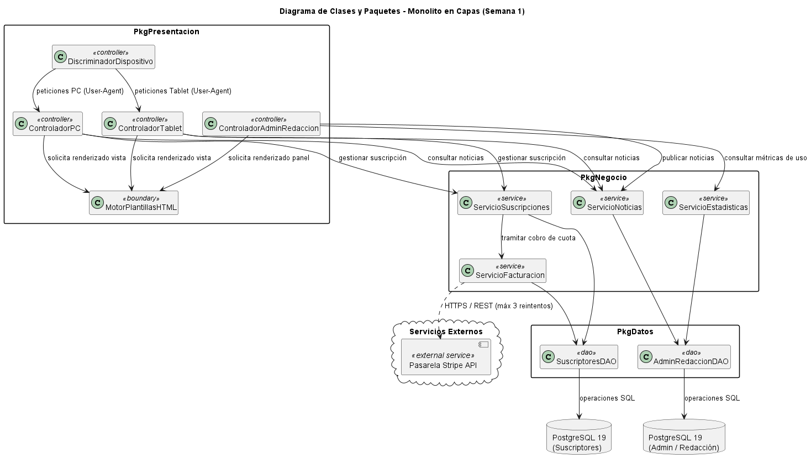
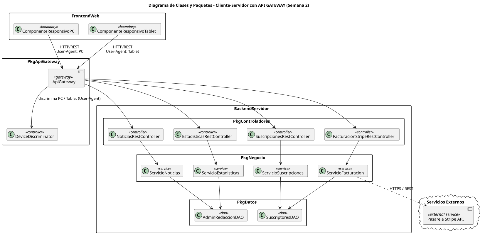

# Sistema de Periodico Digital - Practica 1

## Informacion General
* **Asignatura:** Diseno y Arquitectura del Software (DAS)
* **Curso Academico:** 2026-2027
* **Institucion:** Universidad Rey Juan Carlos (URJC)

## Equipo de Trabajo y Asignacion de Roles
El equipo aplica la separacion de roles establecida en la normativa de la asignatura:

| Integrante | Rol Asignado | Responsabilidades Principales |
| :--- | :--- | :--- |
| **Antonio Machuca** | Arquitecto Software Senior (ASS) | Formulacion y captura de decisiones arquitectonicas en formato MADR. |
| **Enrique Aldama** | Arquitecto Software Senior (ASS) | Formulacion y captura de decisiones arquitectonicas en formato MADR. |
| **Sergio Gonzalez** | Arquitecto Software Cognitivo (ASC) | Cuestionamiento critico, deteccion de fricciones y propuesta de alternativas. |
| **Sara Guillen** | Arquitecto Software Cognitivo (ASC) | Cuestionamiento critico, analisis de requisitos y validacion de arquitectura. |
| **David Sticea** | Arquitecto Software Junior (ASJ) | Modelado y documentacion UML en PlantUML (diagramas de clases y paquetes). |
| **Elena Romera** | Arquitecto Software Junior (ASJ) | Modelado y documentacion UML en PlantUML (diagramas de clases y paquetes). |

Los arquitectos senior son los encargados de tomar y documentar las decisiones de diseño.

Los arquitectos cognitivos revisamos esas decisiones y planteamos dudas cuando consideramos que alguna solución podría mejorarse o que existen otras alternativas.

Por último, los arquitectos junior representan las decisiones aceptadas en los diagramas UML.

## Estructura del Repositorio
El repositorio organiza los elementos del diseno en tres carpetas:

* `Requisitos/`: Contiene los requisitos funcionales y de dominio del sistema.
* `Decisiones/`: Contiene los registros de decision arquitectonica (ADR) en formato MADR estandar.
* `Arquitecturas/`: Contiene los modelos UML en formato PlantUML (.puml) y sus exportaciones graficas (.svg, .png).

<!-- NO TENGO CLARO QUE ESTO LO HAYAMOS SEGUIDO

## Entregables de la Semana 1

### 1. Catalogo de Requisitos
* **Ubicacion:** `Requisitos/REQUISITOS.xlsx`
* **Descripcion:**
  * **12 Requisitos Funcionales (RF1 a RF12):** 
  * **9 Requisitos de Dominio (RD1 a RD9):** 

### 2. Registro de Decisiones Arquitectonicas (MADR)
* **ADR-0001: Seleccion del Estilo Arquitectonico Global**
  * *Requisito Clave:* RF1 (Discriminacion del cliente) y RD9 (Clientes soportados PC y Tablet).
  * *Decision Inicial:* Monolito en capas MVC con renderizado en servidor para validar el dominio en el arranque.
  * *Estado:* Superada por ADR-0003 tras el debate tecnico con los ASC.
* **ADR-0002: Estrategia de Segregacion de Datos PostgreSQL 19**
  * *Requisito Clave:* RD5 (Segregacion fisica obligatoria de datos) y RD2 (Preservacion de anonimato en suscripciones).
  * *Decision:* Dos instancias independientes de PostgreSQL 19 en servidores y puertos separados (5432 y 5433) conectadas mediante DAOs desacoplados (`AdminRedaccionDAO` y `SuscriptoresDAO`).
  * *Estado:* Aceptada.
* **ADR-0003: Migracion a Estilo Arquitectonico Cliente-Servidor con API REST**
  * *Requisito Clave:* RD7 (Comunicacion mediante HTTP/REST).
  * *Decision:* Desacoplamiento de Frontend Web responsivo y Backend API REST sin estado, resolviendo las fricciones de rendimiento y cumplimiento normativo del monolito.
  * *Estado:* Aceptada (supera a ADR-0001).
-->

## 1. Descripción del trabajo

El objetivo de esta práctica es diseñar la arquitectura software de un periódico digital a partir del caso de estudio.

Para ello, hemos analizado los requisitos funcionales y de dominio, hemos planteado diferentes decisiones arquitectónicas y hemos representado las soluciones mediante diagramas UML de clases y paquetes.

El sistema que tenemos que diseñar cuenta con las siguientes funcionalidades:

- Una interfaz web responsiva para PC y Tablet.
- Suscripción y baja anónima a noticias de política, economía, sociedad, nacionales e internacionales.
- Tres modalidades de suscripción: trimestral (70 €), semestral (130 €) y anual (190 €).
- Gestión de pagos mediante Stripe, permitiendo hasta tres reintentos cuando falla un pago.
- Estadísticas de uso para administradores y redactores.
- Dos bases de datos PostgreSQL 19: una para administradores y redactores y otra para suscriptores.

Durante el desarrollo de la práctica hemos tenido que revisar algunas de las decisiones iniciales, ya que no todas las soluciones propuestas eran correctas para poder llevar a cabo todos los requisitos que se nos pedían y con la arquitectura que queríamos construir. Por eso, las discusiones entre arquitectos senior y cognitivos han sido una parte importante del trabajo. Nos han permitido cuestionar las decisiones, comparar alternativas y corregir algunos problemas antes de continuar con el diseño UML.

## 4. Análisis de requisitos

### 4.1. Requisitos funcionales

En el archivo [REQUISITOS.xlsx](Requisitos/REQUISITOS.xlsx) hemos recogido los seis requisitos funcionales principales del sistema.

| ID | Nombre | Descripción |
|---|---|---|
| RF1 | Discriminación del cliente | El sistema debe distinguir entre los clientes PC y Tablet. |
| RF2 | Suscripción y baja anónima | Los lectores pueden suscribirse y darse de baja de las diferentes categorías de noticias de forma anónima. |
| RF3 | Modalidades de suscripción | El sistema permite seleccionar suscripciones trimestrales, semestrales y anuales con sus correspondientes importes. |
| RF4 | Cobro externalizado | El sistema debe realizar los cobros mediante una pasarela externa. |
| RF5 | Reintentos de pago | Cuando falla un pago, el sistema debe permitir reintentarlo hasta tres veces. |
| RF6 | Estadísticas de uso | Los administradores y redactores pueden consultar las noticias más leídas, el tiempo de permanencia, las tasas de rebote y las conversiones a suscriptores. |

### 4.2. Requisitos de dominio

También hemos identificado tres requisitos de dominio.

| ID | Nombre | Descripción |
|---|---|---|
| RD1 | Uso de Stripe | La pasarela de pago utilizada debe ser Stripe. |
| RD2 | Comunicación HTTP/REST | Las peticiones entre el frontend y el backend deben realizarse mediante HTTP/REST. |
| RD3 | Bases de datos PostgreSQL 19 | El sistema debe utilizar dos bases de datos PostgreSQL 19, una para administradores y redactores y otra para suscriptores. |

### 4.3. Revisión de los requisitos iniciales

Durante el análisis inicial planteamos algunos requisitos adicionales porque considerábamos que podían ser necesarios para el funcionamiento del periódico. Sin embargo, después de revisar el enunciado, comprobamos que algunos no estaban bien justificados, dado que los habíamos casado de contexto y no correspondían a requisitos que nos pedían en el caso de estudio. Por este motivo, revisamos los requisitos y mantuvimos los que estaban relacionados con las funcionalidades y restricciones que teníamos que resolver. Esta revisión fue muy importante para poder realizar toda la práctica de manera adecuada.

---
## 5. Semana 1 - Análisis de requisitos y selección del estilo arquitectónico

Durante la primera semana de la práctica se realizó el análisis de los requisitos funcionales y de dominio del periódico digital y se comenzó a definir su arquitectura software. En esta primera fase se plantearon distintas alternativas para organizar el sistema, comenzando con una propuesta monolítica que posteriormente fue revisada y sustituida por una arquitectura cliente-servidor con API REST.

Las decisiones correspondientes a esta primera semana quedaron estudiadas en las ADR-0001.1, ADR-0001.2 y ADR-0001.3.

### 5.1. Decisión inicial: arquitectura monolítica

En la primera decisión arquitectónica, [ADR-0001.1](Decisiones/0001.1-seleccion-estilo-arquitectonico-global.md), los arquitectos senior propusieron una arquitectura monolítica basada en MVC. Esta primera opción permitía organizar la presentación, la lógica de negocio y el acceso a datos dentro de una misma aplicación. Se consideró inicialmente por su sencillez y porque permitía establecer una primera estructura para las funcionalidades del periódico. Sin embargo, durante la revisión realizada por los arquitectos cognitivos se plantearon dudas sobre la separación entre la interfaz web y la lógica de negocio. Se cuestionó la utilidad de mantener ambas responsabilidades dentro de una misma aplicación, además de tener que diferenciar mejor la parte de presentación de los servicios del backend para poder organizar las suscripciones, los pagos mediante Stripe y las estadísticas.

A partir de estas observaciones, los arquitectos senior revisaron la propuesta y volvieron a valorar las alternativas arquitectónicas.

### 5.2. Revisión de las alternativas y cambio de arquitectura

Durante la revisión se consideraron las alternativas recogidas en las decisiones arquitectónicas: una arquitectura monolítica basada en MVC, una arquitectura cliente-servidor con API REST, una arquitectura orientada a servicios (SOA) y una arquitectura de microservicios orientada a eventos.

La propuesta monolítica inicial permitía mantener una estructura sencilla, pero se consideró que una arquitectura cliente-servidor representaba mejor la separación entre el frontend web y el backend que se buscaba para este sistema.

En cuanto a SOA, se descartó porque la incorporación de un bus de servicios y una estructura de integración más amplia añadía demasiada complejidad para lo que se pedía . La alternativa de microservicios también se descartó, ya que suponía dividir el periódico en diferentes servicios independientes y gestionar su comunicación.

Finalmente, se eligió una arquitectura cliente-servidor con API REST. Esta opción permite diferenciar la interfaz utilizada por los lectores de los servicios encargados de gestionar las funcionalidades del periódico y establecer la comunicación HTTP/REST indicada en el requisito RD2.

Tras esta revisión, se documentó la anulación de la propuesta inicial en la [ADR-0001.2](Decisiones/0001.2-anulacion-decision-0001.1.md). La nueva solución quedó recogida en la [ADR-0001.3](Decisiones/0001.3-migracion-estilo-cliente-servidor-api-rest.md).

### 5.3. Arquitectura cliente-servidor con API REST

La arquitectura seleccionada establece una separación entre el frontend web, encargado de la presentación e interacción con los lectores, y el backend, donde se encuentran los servicios relacionados con las noticias, las suscripciones, la facturación y las estadísticas. El frontend debe permitir el acceso desde PC y Tablet, mientras que el backend se encarga de procesar las peticiones y gestionar las operaciones del sistema. La comunicación entre ambas partes se realiza mediante HTTP/REST, como se puede comprobar en el requisito RD2.

### 5.4. Representación de la arquitectura en UML

Según la primera propuesta los arquitectos junior elaboraron un diagrama UML basado en la arquitectura monolítica.

*Figura 1. Primera propuesta de arquitectura monolítica.*

Durante la revisión del diagrama se encontraron algunos aspectos que debían corregirse. El primero estaba relacionado con la organización general del sistema. El diagrama representaba la propuesta monolítica inicial, que posteriormente fue anulada tras la discusión entre los arquitectos senior y cognitivos. Además, en esta primera representación se había incorporado un componente de base de datos antes de haber definido cómo debía organizarse el acceso a los datos.

En esta primera fase el objetivo era definir el estilo arquitectónico, por lo que todavía no era necesario entrar en tanto detalle sobre las bases de datos. Esto no significa que no deban aparecer en la arquitectura, ya que se exige dos bases de datos PostgreSQL 19: una para administradores y redactores y otra para suscriptores.

Por tanto, el primer UML se mantiene como parte de la evolución del proyecto, aunque no representa la arquitectura finalmente seleccionada. La revisión permitió comprobar la importancia de que los componentes y las relaciones del diagrama se correspondan con las decisiones arquitectónicas tomadas.

### 5.5. Resultado de la primera semana

La primera semana finalizó con el análisis de requisitos mejorado y simplificado, ciñiéndose a lo que se pidiese y la elección de una arquitectura cliente-servidor con API REST. La propuesta monolítica inicial fue anulada después de las observaciones realizadas por los arquitectos cognitivos y de la comparación con otras alternativas. Las decisiones ADR-0001.1, ADR-0001.2 y ADR-0001.3 recogen la evolución de este primer problema de diseño.

La representación UML inicial también permitió detectar aspectos que debían revisarse antes de continuar desarrollando las clases y paquetes del sistema.

---

## 6. Semana 2 - Seguimiento de la arquitectura e incorporación del API Gateway

Durante la segunda semana se continuó desarrollando la arquitectura a partir del estilo cliente-servidor seleccionado anteriormente.

En esta fase se comenzaron a resolver problemas de diseño más concretos, relacionados con la distribución de responsabilidades entre los componentes del sistema. Una de las decisiones tratadas fue la incorporación de un API Gateway para resolver el requisito RF1, que establece que el periódico digital debe distinguir entre los clientes PC y Tablet.

### 6.1. Decisión 0002 - Incorporación del API Gateway

En la [ADR-0002.1](Decisiones/0002.1-api-gateway-discriminacion-clientes.md), los arquitectos senior propusieron incorporar un API Gateway como punto de entrada de las peticiones HTTP/REST. La finalidad de este componente era realizar la identificación del tipo de dispositivo antes de que las peticiones llegaran a los controladores del backend.

Para resolver este problema se valoraron diferentes alternativas, como realizar la identificación desde el frontend, utilizar un middleware en el backend o incorporar un API Gateway. En el caso del frontend, se podría utilizar CSS y JavaScript para adaptar la interfaz según el dispositivo, pero esto no garantiza que el backend sepa si el usuario está accediendo desde un PC o una Tablet.

Por otra parte, el middleware permitiría identificar los dispositivos directamente desde el backend, sin necesidad de añadir otro componente. Finalmente, los arquitectos senior eligieron el API Gateway porque permitía realizar esta identificación por separado, sin que los controladores del backend tuvieran que encargarse de ello.

Esta decisión fue cuestionada posteriormente por los arquitectos cognitivos, ya que se planteó si realmente era necesario añadir este componente a la arquitectura.
### 6.2. Revisión crítica de los arquitectos cognitivos

Durante la revisión de la decisión se cuestionó si realmente era necesario incorporar un API Gateway únicamente para distinguir entre PC y Tablet, ya que esto suponía añadir otro componente a la arquitectura del periódico.

Esta duda quedó recogida en la [ADR-0002.2](Decisiones/0002.2-cuestionamiento-incorporacion-api-gateway.md), donde se planteó si esta función podía resolverse de una forma más sencilla. Como respuesta se explicó que el profesor Rafael Capilla había recomendado utilizar un API Gateway para separar la identificación de dispositivos del backend. Además, para evitar complicar demasiado la arquitectura se decidió que el API Gateway solo tendría dos funciones: identificar si el usuario accede desde un PC o una Tablet y redirigir las peticiones HTTP/REST al controlador correspondiente. De esta forma, se mantenía la identificación de dispositivos separada del resto de funcionalidades del periódico, sin añadir más responsabilidades al API Gateway.

### 6.3. Reafirmación de la decisión

Después de la discusión entre los arquitectos senior y cognitivos se decidió mantener el API Gateway. Esta decisión quedó recogida en la [ADR-0002.3](Decisiones/0002.3-reafirmacion-incorporacion-api-gateway.md).

Aunque se había cuestionado su incorporación, los senior consideraron que era una buena opción porque permitía identificar los dispositivos sin que los controladores de noticias, suscripciones y pagos tuvieran que realizar esta comprobación, aunque, también se tuvieron en cuenta sus inconvenientes. Por una parte, se añadía un componente más a la arquitectura y las peticiones tenían que pasar por él antes de llegar al backend. 

Finalmente, se mantuvo la decisión inicial, confirmando que el API Gateway únicamente se encargaría de identificar el dispositivo y redirigir las peticiones. Esta incorporación no supone cambiar la arquitectura cliente-servidor con API REST elegida durante la primera semana, sino añadir un componente para resolver el requisito RF1.

### 6.4. Representación de la arquitectura en UML

Una vez tomadas las decisiones, los arquitectos junior continuaron trabajando en el diagrama UML para representar los cambios realizados en la arquitectura.

*Figura 2. Evolución de la arquitectura cliente-servidor con API REST.*

En este segundo diagrama se representa la separación entre el frontend y el backend, que se comunican mediante HTTP/REST. Además, de incluir el API Gateway.

Según lo establecido en la ADR-0002, el paquete `PkgApiGateway` debe contener el componente `ApiGateway` y la clase `DeviceDiscriminator`, encargada de identificar si el cliente es un PC o una Tablet. Las peticiones HTTP/REST deben pasar primero por el API Gateway y después llegar a los controladores del backend. También es importante que la identificación de dispositivos no se repita en otros componentes, ya que precisamente se ha elegido el API Gateway para encargarse de esta función. Por tanto, los arquitectos junior deben comprobar que estos elementos aparecen correctamente representados en el diagrama UML.

### 6.5. Resultado de la segunda semana

Durante la segunda semana se continuó desarrollando la arquitectura cliente-servidor y se tomó la decisión de incorporar un API Gateway para distinguir entre PC y Tablet. Aunque los arquitectos cognitivos cuestionaron si realmente era necesario añadir este componente, finalmente los senior decidieron mantenerlo, limitando sus funciones para no complicar demasiado la arquitectura.

Todo este proceso quedó recogido en las ADR-0002.1, ADR-0002.2 y ADR-0002.3, donde se documentaron la decisión inicial, las dudas planteadas y su posterior verificación.
