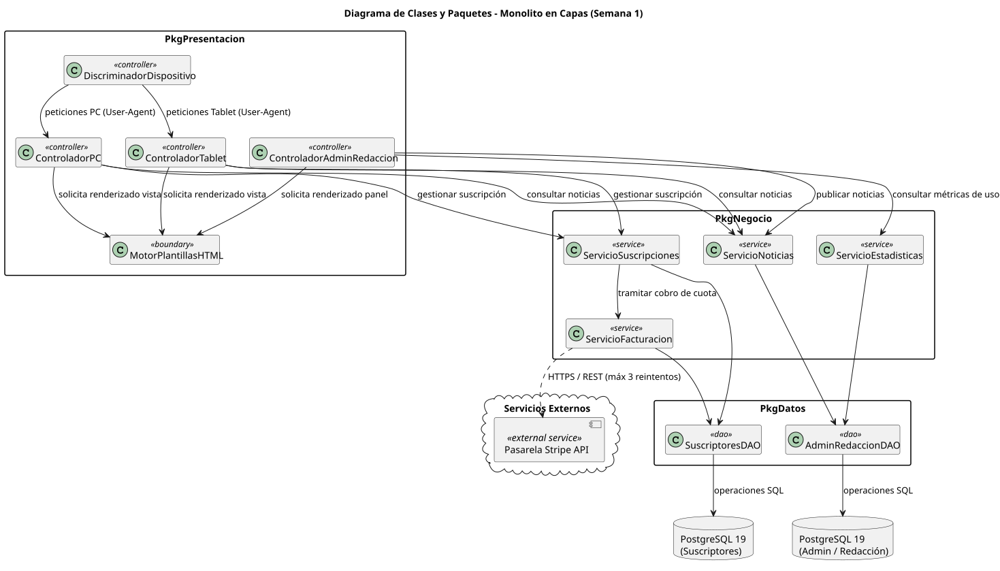

# Sistema de Periodico Digital - Practica 1

## Informacion General
* **Asignatura:** Diseno y Arquitectura del Software (DAS)
* **Curso Academico:** 2026-2027
* **Institucion:** Universidad Rey Juan Carlos (URJC)

## Equipo de Trabajo y Asignacion de Roles
El equipo aplica la separacion de roles establecida en la normativa de la asignatura:

| Integrante | Rol Asignado | Responsabilidades Principales |
| :--- | :--- | :--- |
| **Antonio Machuca** | Arquitecto Software Senior (ASS) | Formulacion y captura de decisiones arquitectonicas en formato MADR. |
| **Enrique Aldama** | Arquitecto Software Senior (ASS) | Formulacion y captura de decisiones arquitectonicas en formato MADR. |
| **Sergio Gonzalez** | Arquitecto Software Cognitivo (ASC) | Cuestionamiento critico, deteccion de fricciones y propuesta de alternativas. |
| **Sara Guillen** | Arquitecto Software Cognitivo (ASC) | Cuestionamiento critico, analisis de requisitos y validacion de arquitectura. |
| **David Sticea** | Arquitecto Software Junior (ASJ) | Modelado y documentacion UML en PlantUML (diagramas de clases y paquetes). |
| **Elena Romera** | Arquitecto Software Junior (ASJ) | Modelado y documentacion UML en PlantUML (diagramas de clases y paquetes). |

## Estructura del Repositorio
El repositorio organiza los elementos del diseno en las siguientes carpetas:

* `Requisitos/`: Contiene los requisitos funcionales y de dominio del sistema.
* `Decisiones/`: Contiene los registros de decision arquitectonica (ADR) en formato MADR estandar.
* `Arquitecturas/`: Contiene los modelos UML en formato PlantUML (.puml) y sus exportaciones graficas (.svg, .png).
* `docs/`: Contiene la memoria tecnica oficial en LaTeX y el documento PDF compilado.

---

## Entregables de la Semana 1

### 1. Catalogo de Requisitos
* **Ubicacion:** [`Requisitos/REQUISITOS.xlsx`](Requisitos/REQUISITOS.xlsx)
* **Descripcion:** 6 Requisitos Funcionales principales (RF1 a RF6) y 3 Requisitos de Dominio (RD1 a RD3).

### 2. Registro de Decisiones Arquitectonicas (MADR)
* **[ADR-0001.1: Seleccion Inicial de Estilo Arquitectonico Global](Decisiones/0001.1-seleccion-estilo-arquitectonico-global.md)**
  * *Requisito Clave:* RD3 (Estructuracion inicial de capas y persistencia sobre PostgreSQL 19).
  * *Decision Inicial:* Monolito en capas MVC con renderizado en servidor.
  * *Estado:* Anulada formalmente en ADR-0001.2.
* **[ADR-0001.2: Anulacion de la Decision 0001.1](Decisiones/0001.2-anulacion-decision-0001.1.md)**
  * *Requisito Clave:* RD2 (Comunicacion obligatoria mediante HTTP/REST).
  * *Decision:* Revocacion formal del monolito por acoplamiento e incompatibilidad con RD2 antes del 10 de noviembre.
  * *Estado:* Aceptada.
* **[ADR-0001.3: Migracion a Estilo Arquitectonico Cliente-Servidor con API REST](Decisiones/0001.3-migracion-estilo-cliente-servidor-api-rest.md)**
  * *Requisito Clave:* RD2 (Comunicacion mediante HTTP/REST).
  * *Decision:* Desacoplamiento de Frontend Web responsivo y Backend API REST sin estado (Stateless).
  * *Estado:* Aceptada (sustituye a ADR-0001.1).

### 3. Modelado Arquitectonico UML
* **Diagrama de Clases y Paquetes (Semana 1):**
  

---

## Entregables de la Semana 2

### 1. Registro de Decisiones Arquitectonicas (MADR)
* **[ADR-0002.1: Incorporacion de API Gateway para Discriminacion de Clientes](Decisiones/0002.1-api-gateway-discriminacion-clientes.md)**
  * *Requisito Clave:* RF1 (Discriminacion de clientes PC y Tablet).
  * *Decision:* Incorporacion de API Gateway perimetral con componente `DeviceDiscriminator`.
  * *Estado:* Aceptada.
* **[ADR-0002.2: Cuestionamiento Critico de Incorporacion de API Gateway](Decisiones/0002.2-cuestionamiento-incorporacion-api-gateway.md)**
  * *Requisito Clave:* RF1 (Discriminacion de clientes PC y Tablet).
  * *Decision:* Debate tecnico promovido por los ASC para evitar sobreingenieria y evaluar alternativas en frontend y middleware.
  * *Estado:* Aceptada.
* **[ADR-0002.3: Reafirmacion de Incorporacion de API Gateway](Decisiones/0002.3-reafirmacion-incorporacion-api-gateway.md)**
  * *Requisito Clave:* RF1 (Discriminacion de clientes PC y Tablet).
  * *Decision:* Ratificacion tecnica por los ASS delimitando estrictamente el API Gateway a identificacion y enrutamiento.
  * *Estado:* Aceptada.

### 2. Modelado Arquitectonico UML
* **Diagrama de Clases y Paquetes (Semana 2):**
  

---

## Memoria Tecnica Oficial

El desarrollo extenso del proyecto, descripcion de requisitos, transcripcion de discusiones criticas ASS-ASC, referencias bibliograficas e indices se recogen en la memoria oficial:
* **Documento PDF compilado:** [`docs/main.pdf`](docs/main.pdf)
* **Fuentes LaTeX estructuradas:** [`docs/main.tex`](docs/main.tex) y [`docs/chapters/`](docs/chapters/)
